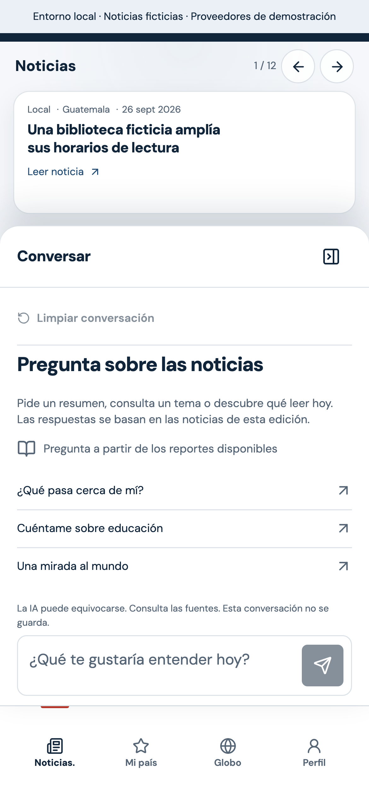
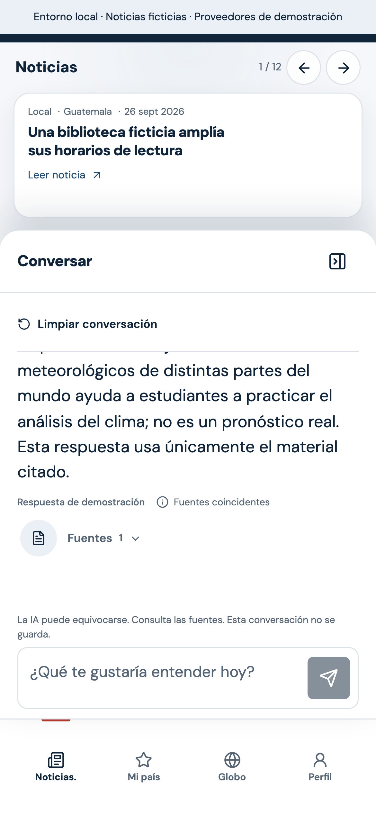

# Ajustes de iOS PWA y prueba real de Pexels

## Fallos corregidos

- La barra de filtro estaba sticky y ocultaba su contenido al hacer scroll. En móvil ahora se desplaza con la portada y mantiene disponible el filtro al volver arriba.
- El lanzador del chat usaba una distancia fija de 80 px: con la navegación de 65 px más el área segura inferior del iPhone quedaba tapado. Ahora usa la altura real de navegación más 12 px.
- El panel solo ocupaba aproximadamente el 40 % de la pantalla. Ahora comparte la zona útil con una tarjeta de noticia compacta y deja el espacio restante al chat. El reporte completo se abre con «Leer noticia».
- Se retiraron del carrusel el eyebrow y las leyendas extensas de las imágenes. La procedencia sigue disponible en el artículo completo.
- El teclado se posiciona con la altura y el desplazamiento del visualViewport, evitando restarlo de nuevo a dvh. Los campos móviles usan 16 px para evitar el zoom de foco de Safari.
- Cerrar, enviar o limpiar conserva el foco hasta que se procesa el toque; el cambio de tamaño por blur ya no puede mover el control antes de completar el click.

## Verificación

`npm run test:presentation` pasó con Chromium y WebKit 27.2. Se verificaron navegación, áreas seguras simuladas de 44/34 px, ausencia de franja sticky, compositor con teclado/viewport desplazado y envío por toque con el chat real conectado a Auth/Functions/Firestore emulados. No equivale a ejecutar la PWA en el iPhone físico del usuario.

La compilación PWA y la apertura sin conexión también pasaron. El runner cierra sus navegadores, el servidor de pruebas y el grupo propio de emuladores. Para instalar los motores de prueba: `npm --prefix frontend run test:e2e:install`.

## Pexels en producción

Se guardó PEXELS_API_KEY en Secret Manager y se vinculó únicamente a la función de Proyecto 2. IMAGE_PROVIDER ahora es pexels; Gemini conserva su clave y configuración. La inspección de Cloud Functions confirmó estado ACTIVE, proveedor pexels, ambas claves vinculadas por nombre/versión y health HTTP 200. No hay claves privadas en la configuración del navegador.

La API real devolvió cinco fotos para la búsqueda `public library books`. El flujo de servicios createDraft → addSource → setImage → assess → publish creó una noticia ficticia por solicitud del usuario y guardó su auditoría. Se emplearon las clases reales del backend y Firestore REST autenticado como operador; no se presenta como una prueba de login editorial Google en el navegador.

- Noticia: https://proyecto2responsibleai.web.app/news/117e2022-a0a0-4ffe-940f-0f2eee9d21b0
- Foto: «Cozy library bookshelf with diverse collection», Melike / Pexels.
- Imagen optimizada: 1200 × 627, 125897 bytes; URL con compresión y recorte.
- Metadatos verificados al releer Firestore: proveedor, URL original, página de procedencia, fotógrafo, licencia, fecha, generatedByAI=false y alteredByAI=false.
- La noticia indica que el escenario es ficticio y la foto es ilustrativa; no afirma documentar un evento real en Guatemala.

Evidencia estructurada: `pexels-demo-verification.json`.

## Actualizar la aplicación instalada

Cerrar y volver a abrir la PWA; si aparece «Hay una nueva edición», tocar «Actualizar». Volver a comprobar scroll, lanzador, teclado y envío en el iPhone físico después de cargar la nueva versión.
